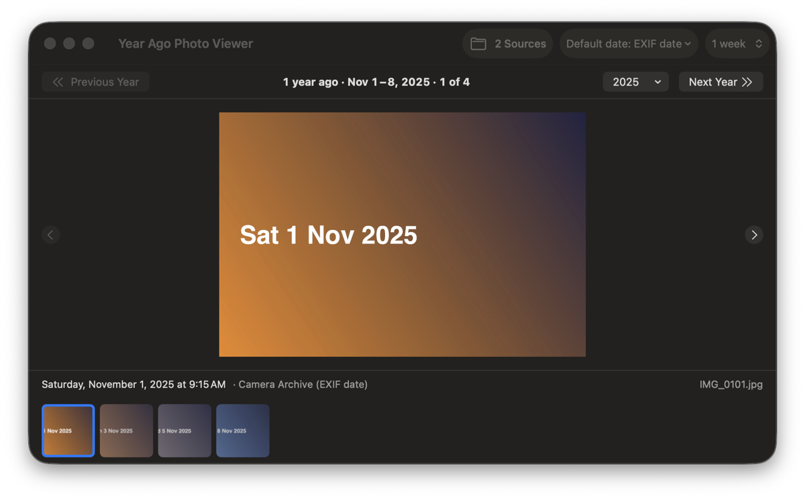
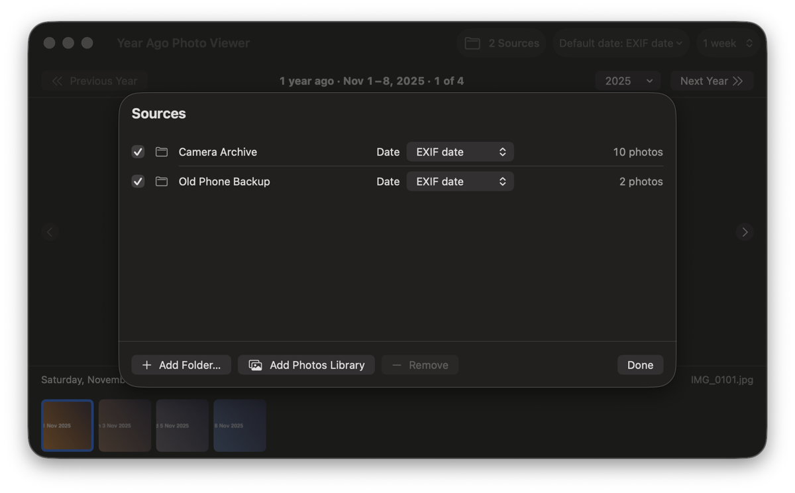

# Year Ago Photo Viewer

A small macOS app that shows the photos you took around this time in past
years. Open it to step through last year's photos from the past week. Press
**Next Year** to see the same week two years ago, then three.



## Features

- **Past weeks, year by year.** See the 1–6 weeks leading up to today's date,
  N years ago. Step through one year's photos, then move to the next year.
- **Your photos, wherever they are.** Use the Mac's Photos library, any number
  of folders, or both. Their photos merge into one timeline.
- **Your choice of date.** Each source dates photos by EXIF capture date, file
  name (such as `Screenshot 2022-03-16 at 13.50.15.png`), created date, or
  modified date.
- **One copy of each photo.** RAW+JPEG pairs show once. Identical copies show
  once, at the earliest date. Live Photos show their still frame. Videos are
  skipped.
- **Fast.** A saved index means later launches only check for changes. New
  photos appear within seconds.
- **Drives come and go.** A folder on an unplugged drive shows as offline and
  comes back when the drive does.
- **At a glance.** An "On This Day" menu bar item shows a photo from a year
  ago. A desktop widget shows one, three, or six photos.



## Requirements

- macOS 26 or later
- Xcode 27 or later, to build

## Building

1. Copy the signing template:

   ```sh
   cp Config/Local.xcconfig.template Config/Local.xcconfig
   ```

2. Optional: edit `Config/Local.xcconfig` to set your bundle ID prefix and
   development team. Git ignores this file, so your values stay private.
   - **Without a team,** the app is signed ad hoc. That's fine for local use.
   - **With a team,** set `DEVELOPMENT_TEAM` and use
     `CODE_SIGN_IDENTITY = Apple Development`. A free personal team works.
     The widget needs a team; see below.

3. Open `YearAgoPhotoViewer.xcodeproj` and run the **YearAgoPhotoViewer**
   scheme. Or build from the command line:

   ```sh
   xcodebuild -project YearAgoPhotoViewer.xcodeproj \
     -scheme YearAgoPhotoViewer -configuration Release build
   ```

### The widget and App Groups

The widget reads a snapshot the app writes into a shared App Group folder.
App Groups need a development team, so:

- **Without a team,** the build leaves the App Group out. Everything works
  except the widget, which shows a setup message.
- **With a team,** the build picks entitlements that include the App Group
  automatically (see `Config/Base.xcconfig`). Set `APP_GROUP_ID` in
  `Local.xcconfig`; a Team-ID-prefixed ID such as `ABCDE12345.yearago`
  avoids a macOS access prompt.

## Using it

1. **Add a source.** Click **Add Folder…** on the welcome screen, or open
   **Sources…** (⇧⌘O) to add folders or the Photos library.
2. **Step through photos.** Use ← and →, the arrow buttons, or the filmstrip.
3. **Change year.** Use **Next Year** / **Previous Year**, ⌘] / ⌘[, or the
   year menu.
4. **Adjust.** Pick the window length (1–6 weeks) in the toolbar. In
   **Settings** (⌘,) choose whether to show years with no photos.

Each source has its own date setting in the Sources panel. The toolbar's
**Default date** applies to new sources, and can apply to all at once.

## Testing

Core logic lives in a Swift package with its own tests:

```sh
swift test --package-path Packages/YearAgoCore
```

A 100,000-file scale test is opt-in:

```sh
YAPV_SCALE_TEST=1 swift test --package-path Packages/YearAgoCore -c release --filter scale100k
```

[docs/manual-test-checklist.md](docs/manual-test-checklist.md) covers what unit
tests can't: the Photos library, permissions, drives, and the widget.

Before committing, check that no personal data slipped in:

```sh
Scripts/check-privacy.sh
```

## Privacy

- **Read-only.** The app never changes, moves, or deletes photos.
- **On your Mac.** It has no network access and sends no telemetry.
- **Sandboxed.** It reads only folders you choose and, if you add it, the
  Photos library.
- **Local index.** Its index lives in the app's sandbox container under
  Application Support. Removing a source deletes that source's index.

## Project layout

| Path | Contents |
|------|----------|
| `App/` | The macOS app: SwiftUI views, view model, PhotoKit and file access |
| `Packages/YearAgoCore/` | Core logic with no UI: dates, windows, index, duplicates |
| `Config/` | Shared build settings and the signing template |
| `Widget/` | The WidgetKit extension |
| `Packages/YearAgoCore/Sources/YearAgoSnapshot/` | Snapshot format shared by the app and widget |
| `Scripts/` | Icon generator and privacy check |
| `docs/` | Proposal, implementation plan, checklist, screenshots |

The screenshots use generated sample images, not real photos.

## License

MIT. See [LICENSE](LICENSE).
